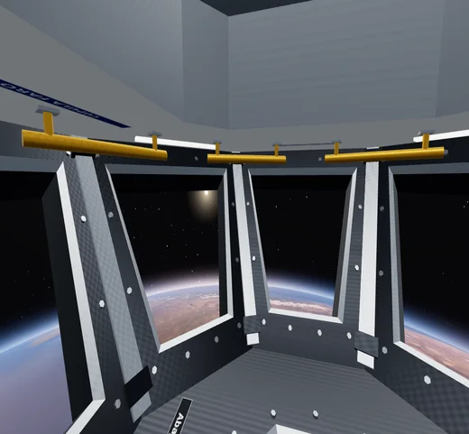

# XR Logística Lab · Artigas-1

<p align="center">
  <strong>A mixed-reality lab for teaching logistics and engineering on Meta Quest — with a teacher dashboard, a 3D model library and Artigas-1, a zero-gravity logistics simulator aboard a space station.</strong>
</p>

<p align="center">
  <a href="https://gabrielbengoechea.github.io/xr-logistica-lab/">Student portal</a> ·
  <a href="https://gabrielbengoechea.github.io/xr-logistica-lab/artigas1/">Artigas-1 web walkthrough</a> ·
  <a href="README.es.md">Leer en español</a>
</p>

<p align="center">
  
</p>

> **Status:** prototype in active development. Components have automated tests; behaviour on a physical Meta Quest headset is still being validated (see [Roadmap](#roadmap)).

## Overview

XR Logística Lab is a learning environment for Logistics Engineering students. In the headset, students assemble and disassemble real equipment in exploded view, and every part snaps into place:

- forklift · EUR pallet · selective rack · photoelectric sensor · three-phase motor · CubeSat 1U

While they practice, the headset sends session metrics (times, assembly errors, interactions) to a live teacher dashboard.

The repository also contains **Artigas-1**, a logistics simulator set on a fictional Uruguayan space station in microgravity: moving by handrails, handling cargo with mass, storing it in racks with rules, scanning labels, running inventory activities and performing a spacewalk inspection.

## Architecture

```
Quest (Unity) ──HTTP POST /api/v1/telemetry/session──▶ FastAPI ──WS /ws/telemetry──▶ Teacher dashboard (React)
      ▲                                                 │
      └──── GET /api/v1/models/manifest, /inventory ────┘
/models ──(manifest.json + .glb)──▶ backend ──▶ three.js viewer and glTFast in Unity
```

| Folder | Contents | Technology |
|---|---|---|
| [`models/`](models/README.md) | 3D assets generated by script, with parts for exploded view and snap points, plus `manifest.json` | Blender 5.2 (bpy) · `.blend` `.fbx` `.glb` |
| `backend/` | REST + WebSocket API: inventory, VR session telemetry, model manifest | Python 3.11+, FastAPI, Pydantic v2, SQLite |
| `web-dashboard/` | Student portal, 3D model viewer and live teacher panel | React 18, TypeScript, Vite, Tailwind CSS, three.js, React Three Fiber |
| `vr-client/` | Mixed-reality app: passthrough, hands, exploded view, snapping, telemetry | Unity 6, C#, OpenXR, XR Interaction Toolkit 3, XR Hands, Meta OpenXR |
| [`artigas1-vr/`](artigas1-vr/README.md) | Artigas-1 Unity project, its Blender 3D kit and test tools | Unity 6, C#, XR Interaction Toolkit 3, OpenXR, URP |
| `web-dashboard/public/artigas1/` | Artigas-1 browser walkthrough (desktop or Quest via WebXR) | three.js 0.170, WebXR |

## Artigas-1 at a glance

Implemented in the repository (details and test reports in [`artigas1-vr/`](artigas1-vr/README.en.md)):

- Zero-gravity locomotion: hand-over-hand movement on handrails, inertia, damping and wall collisions; *Comfort* and *Realistic* modes, comfort vignette and snap turn with fade.
- Cargo with mass, category and size; rack slots that validate each placement (LED feedback).
- Handheld barcode scanner, RFID portal volume and shift manifest with discrepancies.
- Activities with intro, objective, instructions and score (cargo placement, inventory control, inspection).
- Station map on a tablet in the left hand, astronaut gloves on the hands.
- Spacewalk scene with tether, solar arrays, radiators and an Earth with day/night and city lights over Uruguay.
- Same telemetry contract as the main lab, so Artigas-1 sessions appear in the teacher dashboard.

## Getting started

### Web dashboard and backend

```bash
# Backend
cd backend && python3 -m pip install -r requirements-dev.txt
cd backend && uvicorn app.main:app --reload --port 8000   # API docs at http://localhost:8000/docs

# Web dashboard
cd web-dashboard && npm ci
cd web-dashboard && npm run dev                            # http://localhost:5173 (proxies /api and /ws to :8000)
```

### Unity projects (`vr-client/`, `artigas1-vr/`)

Requirements: Unity 6 with **Android Build Support**, a Meta Quest 2 or 3 with Touch controllers.

> ⚠️ **To confirm:** `ProjectSettings/ProjectVersion.txt` lists `6000.0.32f1`, while recent commit notes mention compiling with Unity 6.6 (`6000.6.9f1`). Please confirm the editor version in use.

Step-by-step setup (project template, packages, XR plug-in settings and the *Artigas-1* editor menu) is documented in [`artigas1-vr/README.md`](artigas1-vr/README.md) (Spanish) and summarized in [`artigas1-vr/README.en.md`](artigas1-vr/README.en.md).

### Tests

```bash
cd backend && python3 -m pytest -q
cd web-dashboard && npm test
cd vr-client/Tools/verificar-compilacion && dotnet build -warnaserror   # compiles Unity scripts against API stubs
cd artigas1-vr/Tools/pruebas-logica && dotnet run                     # Artigas-1 pure-logic tests
```

CI runs these checks with GitHub Actions (`.github/workflows/`), and `pages.yml` publishes the static portal to GitHub Pages.

## Screenshots

| Artigas-1 | More media |
|---|---|
|  | _Placeholder — add real captures from the headset build (e.g. `docs/media/`)._ |

## Roadmap

- [ ] Validate comfort and performance on Meta Quest 2 (target: stable 72 fps; motion-sickness test with 10 participants).
- [ ] Confirm Unity editor version and publish a tested APK build process.
- [ ] Add headset screenshots and a short demo video.
- [ ] Artigas-1 phase 2: Colonia module with RFID portal, cargo straps and ratchet, wrist tablet with tasks and manifest.
- [ ] Add `scan`, `rfid`, `strap` and `alarm` events to the telemetry contract.
- [ ] Teacher authentication and cloud-hosted backend.
- [ ] Choose and add a license.

## Contributing

Issues and suggestions are welcome. Development uses `feature/<topic>` branches and pull requests into `main` with checks passing. Code conventions (Spanish user-facing text, English API identifiers) are described in [`CLAUDE.md`](CLAUDE.md).

## Credits

- Project lead: [Gabriel Bengoechea](https://github.com/gabrielbengoechea) — Logistics Engineering, UTEC Uruguay.
- Developed with AI-assisted coding (Anthropic's Claude), as recorded in the commit history.
- 3D models are generated procedurally with Blender scripts included in this repository.
- Earth imagery, third-party packages and their licenses: _placeholder — to be listed before a public release._

## License

_No license has been chosen yet. Until one is added, all rights are reserved by the author._
