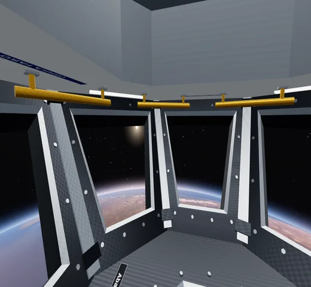

# Artigas-1 | Immersive Space Logistics Experience

<p align="center">
  <strong>A zero-gravity logistics simulator aboard the fictional Uruguayan space station Artigas-1, built with Unity for Meta Quest — with a companion browser walkthrough in WebXR.</strong>
</p>

<p align="center">
  <br/>
  <a href="https://gabrielbengoechea.github.io/xr-logistica-lab/artigas1/">Try the web walkthrough</a> · <a href="README.md">Documentación completa en español</a>
</p>

> **Status:** prototype. The Unity project compiles and runs in the editor; testing on a physical Meta Quest headset is pending. The web walkthrough is covered by automated browser tests with simulated controllers.

## Overview

Artigas-1 lets Logistics Engineering students practice warehouse tasks in microgravity: moving around by handrails, handling cargo whose mass matters, storing it in rack slots with rules, scanning labels and keeping the shift manifest consistent. It lives inside [XR Logística Lab](../README.md) and uses the same telemetry contract, so sessions appear in the teacher dashboard.

## Experience (implemented)

- **Zero-G locomotion:** hand-over-hand on handrails; release velocity with a cap; damping and wall collisions; *Comfort* / *Realistic* modes; acceleration-based comfort vignette.
- **Cargo handling:** bags and rigid containers with mass, category, size and state; heavy cargo lags behind the hand and loads over 30 kg require two hands.
- **Rack slots:** validate size, mass, category and occupancy, with green/amber/red/cyan LED feedback.
- **Tools:** handheld barcode scanner (1.5 m ray, reads labels under 45°), RFID portal volume, shift manifest and discrepancies.
- **Activities:** intro, objective, instructions and score — cargo placement, inventory control, scanning and inspection.
- **Station map** on a tablet in the left hand and **astronaut gloves** on the hands.
- **Spacewalk** (scene `F5_Exterior`): thermal blankets, solar arrays, radiators, antenna, handrails, a safety tether that stops the astronaut, and an Earth with day, night, atmosphere and city lights.
- **Quest optimizations:** baked lighting menu, fixed foveated rendering, reduced shader variants (Vulkan only).

## Technology

| Item | Version / detail |
|---|---|
| Unity | Unity 6 with Android Build Support — ⚠️ _to confirm_: `ProjectVersion.txt` says `6000.0.32f1`; recent commits mention `6000.6.9f1` |
| Packages | XR Interaction Toolkit 3.0.7, OpenXR 1.13.0, Unity OpenXR: Meta 2.1.0, XR Management 4.5.0, Input System 1.11.2, URP 17.0.3 (`Packages/manifest.json`) |
| Headset | Meta Quest 2 with Touch controllers (also targets Quest 3) |
| Language | C# (namespace `Artigas1`); pure logic in `Scripts/Core` testable outside Unity |
| 3D kit | Blender Python scripts in [`Blender/`](Blender/) |
| Web walkthrough | three.js 0.170 + WebXR in `web-dashboard/public/artigas1/` |

## Getting started

1. In Unity Hub create a new project from the **VR** template (Unity 6) named `artigas1-vr`.
2. Copy `Assets/Artigas1`, `Assets/XRLab`, `Assets/Tests` and `Tools` from this folder into it, and add the missing dependencies from `Packages/manifest.json`.
3. Import **Starter Assets** from the XR Interaction Toolkit samples.
4. In **XR Plug-in Management → Android**, enable **OpenXR** with the **Meta Quest** feature group and add the **Oculus Touch Controller Profile**.
5. Run the **Artigas-1** menu steps in order (check project → create materials → create prefabs → build scene `F1_Rivera`, then the later phase menus).
6. Optional: set the backend URL in `Sistemas → TelemetryLogger` to send telemetry to the lab dashboard.

Build for Quest:

```bash
Unity -batchmode -quit -projectPath artigas1-vr -executeMethod Artigas1.Editor.BuildScript.BuildQuest \
      -buildOutput Builds/Quest/Artigas1.apk -logFile -
adb install -r artigas1-vr/Builds/Quest/Artigas1.apk
```

Test without Unity: `cd Tools/pruebas-logica && dotnet run`.

Full details (in Spanish): [`README.md`](README.md).

## Controls (Unity build)

| Action | Input |
|---|---|
| Grab handrail / cargo | Grip |
| Use scanner | Trigger |
| Toggle Comfort / Realistic mode | A (right controller) · `M` in editor |
| Brake body | X (left controller) · `F` in editor |
| Movement, turning, map | _Placeholder — confirm final mapping after headset testing_ |

## Media

| Cupola (render) | Headset captures |
|---|---|
|  | _Placeholder — add real captures to `docs/media/`. The editor menu “Artigas-1 / Grabar video del recorrido” can record a demo walkthrough._ |

## Project status

- [x] Phase 1: zero-G locomotion, cargo, rack slots, scanner, RFID portal, FPS meter
- [x] Phases 2–5 in Unity: baked lighting, activities, map tablet, spacewalk scene
- [x] Web walkthrough with automated tests
- [ ] Confirm Unity version and package list
- [ ] Test on Meta Quest 2/3 (72 fps, motion-sickness protocol)
- [ ] Add headset screenshots and a short demo
- [ ] Document final controls and comfort settings
- [ ] Known issues and limitations
- [ ] License and third-party credits

## Credits & license

- Project lead: [Gabriel Bengoechea](https://github.com/gabrielbengoechea), UTEC Uruguay.
- Developed with AI-assisted coding (Anthropic's Claude), as recorded in the commit history.
- Telemetry code shared with [XR Logística Lab](../README.md) `vr-client`.
- Third-party packages, textures and their licenses: _placeholder — to be listed._
- No license has been chosen yet.
